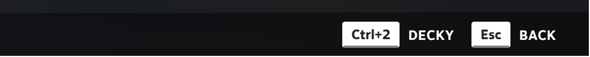
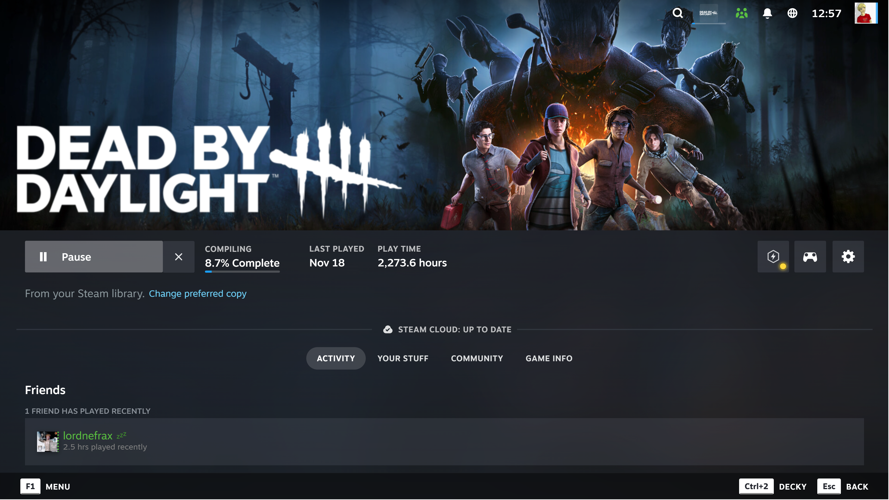
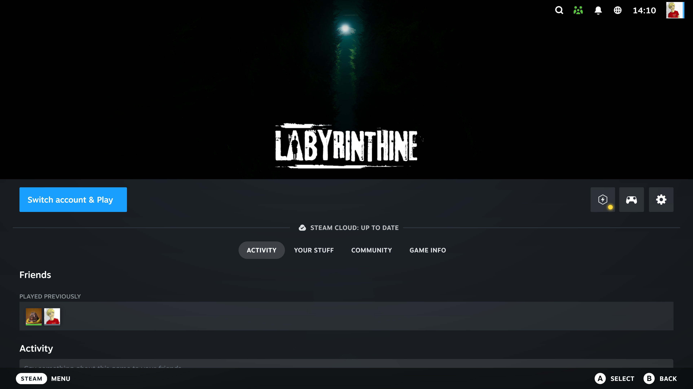

[English](README.md) · **Français**

# Mes plugins Decky

Plugins [Decky Loader](https://decky.xyz/) pour **Steam Big Picture** sous Windows : précompilation
des shaders, bascule vers le compte propriétaire d'un jeu, et un raccourci Decky dans la barre du
bas. Un dossier par plugin, chacun avec un README détaillé en anglais et en français, et des captures
faites sur le vrai client.

Site : **https://jamesdadams.github.io/my-decky-plugins/**

## Plugins

| Plugin | Ce qu'il fait | Installation |
| --- | --- | --- |
| [**DeckyShortcut**](plugins/decky-qam-shortcut/) | Ajoute `Ctrl+2 DECKY` à la barre de raccourcis du bas, juste à gauche de `F9 OPTIONS`, avec l'apparence des légendes Steam. `Ctrl+2` ou un clic ouvre le panneau Decky (l'onglet Decky du menu d'accès rapide) ; la légende est réinsérée dès que Steam reconstruit sa barre. Rien n'est dessiné à la main et rien n'est patché dans Steam : la légende est clonée d'une légende native à l'exécution.<br><br> | [](https://raw.githubusercontent.com/JamesDAdams/my-decky-plugins/main/releases/decky-qam-shortcut-2.1.1.zip) |
| [**SCSKiller**](plugins/scskiller/) | Relie l'application Windows [SCSKiller](https://github.com/BlueHeisenberg/SCSKiller) à Steam : un bouton de compilation de 48×48 px exactement à 8 px à gauche de l'icône manette sur la fiche du jeu, une fenêtre de stats alimentée par ce que SCSKiller remonte (shaders, pipelines, cache, estimation, dernière compilation), et une page du menu d'accès rapide qui liste la file avec la progression en direct. Le plugin n'embarque aucun binaire : il appelle le `scskiller.exe` déjà installé.<br><br> | [](https://raw.githubusercontent.com/JamesDAdams/my-decky-plugins/main/releases/SCSKiller-decky-0.9.15.zip) |
| [**SteamSwitch**](plugins/steamswitch/) | Quand un jeu appartient à un **autre compte Steam** mémorisé sur le PC, Steam affiche **Borrow**. Ce plugin réécrit ce bouton natif en **Switch account & Play** : un helper détaché quitte Steam, déclare le compte propriétaire en connexion automatique (`loginusers.vdf` + registre), relance en Big Picture, attend ce compte puis lance le jeu. Un second bouton sur la page des réglages du compte change de compte sans passer par l'écran de déconnexion. Aucun compte n'est codé en dur.<br><br> | [](https://raw.githubusercontent.com/JamesDAdams/my-decky-plugins/main/releases/SteamSwitch-decky-0.1.4.zip) |

## Prérequis

- Windows avec le client Steam lancé en mode **Big Picture**.
- [Decky Loader](https://decky.xyz/) installé.
- Selon le plugin : le clavier et la souris pour DeckyShortcut, l'application SCSKiller installée pour
  SCSKiller, au moins deux comptes Steam mémorisés pour SteamSwitch. Chaque README détaille les
  limites exactes et les cas d'échec.

Installer un plugin : téléchargez le zip ci-dessus, puis menu Decky → **Install from zip file** →
sélectionnez le zip. Installation manuelle : copiez le dossier du plugin dans
`%USERPROFILE%\homebrew\plugins\` et redémarrez Steam.

## Arborescence

```
plugins/
  decky-qam-shortcut/    légende dans la barre du bas + ouverture du QAM (TypeScript + Python)
  scskiller/             bouton sur la fiche du jeu + pont SCSKiller (TypeScript + Python + PowerShell)
  steamswitch/           réécriture d'un bouton natif + helper de changement de compte (TypeScript + Python)
docs/                    le site statique publié sur GitHub Pages
  index.html, styles.css, app.js
  assets/                toutes les images du site (Pages ne sert que /docs)
  decky-internals.md      notes techniques : fenêtres CEF, executeInTab, QAM
  troubleshooting.md      symptôme -> cause -> vérification
  qam-shortcut-plugin.md  étude de cas du plugin Ctrl+2
  workshop.md             l'index de l'atelier (skills, outillage, plugins)
releases/                zips installables, un par version de plugin
skills/                  skills DSH utilisées pour construire les plugins
tools/                   outillage de vérification CDP (évaluation, clic, capture)
assets/                  badges des README
AGENTS.md                les règles suivies dans ce dépôt
README.md / README.fr.md ce listing (anglais par défaut + français)
```

## Développement

Chaque plugin, c'est du TypeScript (frontend, injecté dans la fenêtre Big Picture visible via
`executeInTab`) et du Python (`main.py`, le backend Decky). Les commandes de build et de vérification
sont dans le README de chaque plugin ; les faits mesurés sur Steam/Decky, les recettes de placement et
les règles du dépôt sont dans [AGENTS.md](AGENTS.md).

## Licence

MIT, par plugin — voir chaque `plugins/<name>/LICENSE`.
