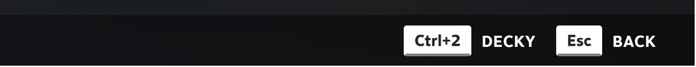
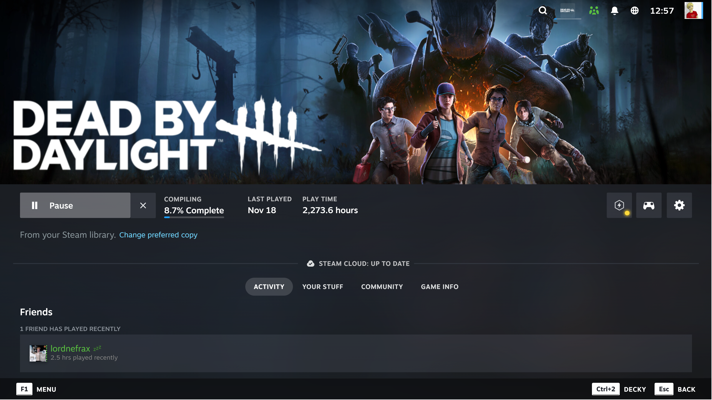
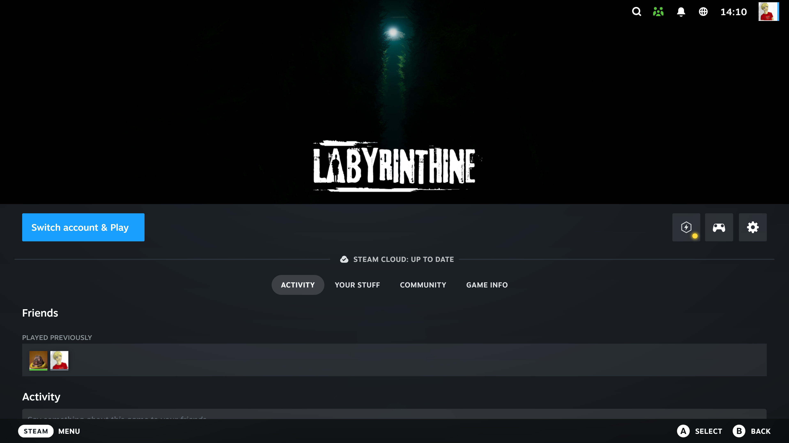

**English** · [Français](README.fr.md)

# My Decky plugins

[Decky Loader](https://decky.xyz/) plugins for **Steam Big Picture** on Windows: shader
precompilation, switching to the account that owns a game, and a Decky shortcut in the bottom bar.
One folder per plugin, each with a detailed README in English and French, plus screenshots taken on
the real client.

Website: **https://jamesdadams.github.io/my-decky-plugins/**

## Plugins

| Plugin | What it does | Installation |
| --- | --- | --- |
| [**DeckyShortcut**](plugins/decky-qam-shortcut/) | Adds `Ctrl+2 DECKY` to the bottom shortcut bar, immediately left of `F9 OPTIONS`, with the look of Steam's own legends. `Ctrl+2` or a click opens the Decky panel (the Decky tab of the Quick Access Menu); the key is re-inserted whenever Steam rebuilds its bar. Nothing is drawn by hand and nothing is patched in Steam: the legend is cloned from a native one at runtime.<br><br> | [](https://raw.githubusercontent.com/JamesDAdams/my-decky-plugins/main/releases/decky-qam-shortcut-2.1.1.zip) |
| [**SCSKiller**](plugins/scskiller/) | Bridges the [SCSKiller](https://github.com/BlueHeisenberg/SCSKiller) Windows app into Steam: a 48×48 shader-compile button exactly 8 px left of the controller icon on the game page, a stats window fed by what SCSKiller reports (shaders, pipelines, cache, estimate, last compile), and a Quick Access Menu page listing the queue with live progress. The plugin ships no binary; it calls the `scskiller.exe` already installed.<br><br> | [](https://raw.githubusercontent.com/JamesDAdams/my-decky-plugins/main/releases/SCSKiller-decky-0.8.5.zip) |
| [**SteamSwitch**](plugins/steamswitch/) | When a game belongs to **another Steam account** remembered on the PC, Steam shows **Borrow**. This plugin rewrites that native button into **Switch account & Play**: a detached helper quits Steam, marks the owning account as the auto-login one (`loginusers.vdf` + registry), restarts in Big Picture, waits for that account and launches the game. A second button on the account settings page switches account without the sign-out screen. No account is hard-coded.<br><br> | [](https://raw.githubusercontent.com/JamesDAdams/my-decky-plugins/main/releases/SteamSwitch-decky-0.1.1.zip) |

## Requirements

- Windows with the Steam client started in **Big Picture** mode.
- [Decky Loader](https://decky.xyz/) installed.
- Per plugin: `Ctrl+2` shortcuts and keyboard/mouse for DeckyShortcut, the SCSKiller app installed
  for SCSKiller, at least two remembered Steam accounts for SteamSwitch. Each README lists the exact
  limits and the failure modes.

Installing a plugin: download the zip above, then Decky menu → **Install from zip file** → select the
zip. Manual install: copy the plugin folder into `%USERPROFILE%\homebrew\plugins\` and restart Steam.

## Layout

```
plugins/
  decky-qam-shortcut/    bottom-bar legend + QAM opening (TypeScript + Python)
  scskiller/             game-page button + SCSKiller bridge (TypeScript + Python + PowerShell)
  steamswitch/           native button rewrite + account switch helper (TypeScript + Python)
docs/                    the static website published on GitHub Pages
  index.html, styles.css, app.js
  assets/                every image the site needs (Pages serves /docs only)
  decky-internals.md      technical notes: CEF windows, executeInTab, QAM
  troubleshooting.md      symptom -> cause -> verification
  qam-shortcut-plugin.md  case study of the Ctrl+2 plugin
  workshop.md             the workshop index (skills, tooling, plugins)
releases/                installable zips, one per plugin version
skills/                  DSH skills used while building the plugins
tools/                   CDP verification tooling (evaluate, click, screenshot)
assets/                  README badges
AGENTS.md                the rules followed in this repository
README.md / README.fr.md this listing (English default + French)
```

## Development

Every plugin is TypeScript (frontend, injected into the visible Big Picture window through
`executeInTab`) plus Python (`main.py`, the Decky backend). Build and verification commands are in
each plugin README; the measured Steam/Decky facts, the placement recipes and the rules for this
repository are in [AGENTS.md](AGENTS.md).

## License

MIT, per plugin — see each `plugins/<name>/LICENSE`.
