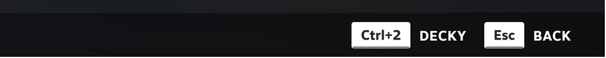

[English](README.md) · **Français**

# DeckyShortcut

Plugin [Decky Loader](https://github.com/SteamDeckHomebrew/decky-loader) pour **Steam Big Picture** :
il ajoute `Ctrl+2 DECKY` à la barre de raccourcis du bas, **immédiatement à gauche de `F9 OPTIONS`**,
avec exactement le même rendu que les autres légendes Steam. `Ctrl+2` (ou un clic dessus) ouvre le
**panneau Decky** (l'onglet Decky du menu d'accès rapide, qui glisse depuis la droite).

| Où / quoi | Rendu |
| --- | --- |
| Barre du bas, à gauche de `F9 OPTIONS` | `Ctrl+2` `DECKY` |
| Clavier / souris | `Ctrl+2` ou clic → ouvre le panneau Decky ; un second appui le referme |
| Manette | rien n'est ajouté : le bouton QAM (`…`) de Steam ouvre déjà le panneau |



Le bouton n'est pas dessiné à la main : c'est un **clone d'une légende Steam native** (même balisage,
mêmes classes), il hérite donc de la police, de la touche, de l'espacement, et suit les mises à jour
visuelles de Steam. Il est retiré en mode manette, où Steam remplace les touches par des glyphes de
commande.

> Dans la liste des plugins, le plugin s'appelle **DeckyShortcut** ; son panneau est intitulé
> « Raccourci Decky ». Les libellés intégrés au jeu sont en français, car le plugin est une livraison
> destinée à un public francophone.

---

## Installation

[](https://raw.githubusercontent.com/JamesDAdams/my-decky-plugins/main/releases/DeckyShortcut-decky-2.1.2.zip)

1. Téléchargez `DeckyShortcut-decky-2.1.2.zip` depuis `releases/`.
2. Decky Loader → ... → **Install from zip file** → sélectionnez le zip.
3. Le plugin se recharge immédiatement ; `Ctrl+2 DECKY` apparaît dans la barre du bas.

Installation manuelle : copiez le dossier dans `~/homebrew/plugins/` (`/home/deck/homebrew/plugins/`
sous SteamOS), puis redémarrez Decky ou le client Steam.

## Réglages

Le panneau du plugin (QAM → icône Decky → onglet du plugin) propose :

- **Activer le rappel et Ctrl+2** — interrupteur principal (bouton et raccourci).
- **Ouvrir le panneau Decky maintenant** — bouton de test (il ouvre, il ne ferme jamais).
- **Détection** — mode de saisie détecté actuellement (clavier/souris ou manette).

Les réglages sont stockés dans le `localStorage` de Steam.

## Fonctionnement (et pourquoi c'est nécessaire)

Mesuré sur le client Windows : Decky charge les interfaces des plugins dans une fenêtre CEF cachée de
**1×1 pixel** (`SharedJSContext`). Tout ce qu'un plugin dessine dans son propre `document` reste
invisible, et aucune touche de l'utilisateur ne l'atteint. C'est ce qui a cassé les deux premières
versions.

Architecture actuelle :

1. le plugin (dans `SharedJSContext`) injecte un script autonome dans la **vraie** fenêtre visible via
   `executeInTab("Steam Big Picture Mode", …)` (CDP, le point d'accès de débogage de Decky) ;
2. ce script clone une légende native du pied de page, la renomme `Ctrl+2` / `DECKY` et l'insère juste
   après l'espaceur flexible de la barre, c'est-à-dire immédiatement à gauche du premier raccourci de
   droite (`F9 OPTIONS`) ; il écoute aussi les clics et `Ctrl+2` ;
3. comme une fenêtre CEF ne peut pas rappeler le contexte du plugin, le script incrémente un compteur
   (`window.__DECKY_HINT_REQ__`) ;
4. le plugin lit ce compteur toutes les 700 ms et, à chaque incrément, ouvre l'onglet QAM de Decky
   depuis `SharedJSContext` avec `MenuStore.OpenQuickAccessMenu(999)` (`QuickAccessTab.Decky`), ou le
   ferme si Decky est déjà affiché.

Comme Steam reconstruit sa barre à chaque changement de contexte (mode de saisie, navigation), le
plugin vérifie toutes les 700 ms que le bouton est toujours là et le réinsère sinon.

Chaque appel à Steam est enveloppé dans un `try/catch` : si Valve renomme un interne, le plugin échoue
en douceur (bouton absent, raccourci inerte) sans casser l'interface.

## Dépannage

Le plugin écrit un journal de diagnostic lisible :

- Windows : `%USERPROFILE%\homebrew\logs\decky-qam-shortcut\*.log`
- SteamOS : `/home/deck/homebrew/logs/decky-qam-shortcut/*.log`

| Ligne | Ce qu'elle prouve |
| --- | --- |
| `frontend: module evaluated …` | le bundle a été importé par Decky |
| `frontend: inject ok tab=… {"ok":true,"showing":true,…}` | le bouton a été inséré dans la bonne fenêtre |
| `frontend: request N -> activate` | un clic ou `Ctrl+2` a été reçu |
| `frontend: openPanel -> requested=true` | l'ouverture du QAM a été demandée |

## Limites connues

- Jusqu'à ~0,7 s de latence avant l'ouverture du panneau (le clic revient par interrogation
  périodique).
- Le raccourci ne fonctionne que lorsque l'interface Steam a le focus : avec un jeu au premier plan
  (overlay fermé), la touche va au jeu. Le bouton QAM de Steam fonctionne toujours.
- Rien n'est ajouté en mode manette (glyphes de commande natifs).
- Si vous avez masqué l'onglet QAM de Decky, le raccourci ne peut rien afficher.
- Mode Big Picture uniquement.

## Compilation

```bash
npm install      # or pnpm install
npm run build    # rollup -> dist/index.js
npm run watch    # rebuild on save
```

## Licence

MIT — voir [LICENSE](LICENSE).

Le squelette de build (rollup, tsconfig, `definePlugin`) suit le
[modèle officiel de plugin Decky](https://github.com/SteamDeckHomebrew/decky-plugin-template).
