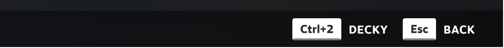

**English** · [Français](README.fr.md)

# DeckyShortcut

[Decky Loader](https://github.com/SteamDeckHomebrew/decky-loader) plugin for **Steam Big Picture**: it
adds `Ctrl+2 DECKY` to the bottom shortcut bar, **immediately left of `F9 OPTIONS`**, with exactly
the same look as the other Steam legends. `Ctrl+2` (or a click on it) opens the **Decky panel** (the
Decky tab of the Quick Access Menu, sliding in from the right).

| Where / what | Rendering |
| --- | --- |
| Bottom bar, left of `F9 OPTIONS` | `Ctrl+2` `DECKY` |
| Keyboard / mouse | `Ctrl+2` or click → opens the Decky panel; pressing again closes it |
| Controller | nothing is added: Steam's QAM button (`...`) already opens the panel |



The button is not hand-drawn: it is a **clone of a native Steam legend** (same markup, same classes),
so it inherits the font, key cap, spacing, and follows Steam's visual updates. It is removed in
controller mode, where Steam replaces key caps with control glyphs.

> In the plugin list the plugin is called **DeckyShortcut**; its panel is titled « Raccourci Decky ».
> The in-game copy is French because the plugin is a French-facing deliverable.

---

## Installation

[](https://raw.githubusercontent.com/JamesDAdams/my-decky-plugins/main/releases/DeckyShortcut-decky-2.1.2.zip)

1. Download `DeckyShortcut-decky-2.1.2.zip` from `releases/`.
2. Decky Loader → ... → **Install from zip file** → select the zip.
3. The plugin reloads immediately; `Ctrl+2 DECKY` shows up in the bottom bar.

Manual install: copy the folder into `~/homebrew/plugins/` (`/home/deck/homebrew/plugins/` on
SteamOS), then restart Decky or the Steam client.

## Settings

The plugin panel (QAM → Decky icon → plugin tab) offers:

- **Activer le rappel et Ctrl+2** — master switch (button and shortcut).
- **Ouvrir le panneau Decky maintenant** — test button (it opens, never closes).
- **Détection** — currently detected input mode (keyboard/mouse or controller).

Settings are stored in Steam's `localStorage`.

## How it works (and why this is necessary)

Measured on the Windows client: Decky loads plugin frontends inside a hidden **1×1 pixel** CEF window
(`SharedJSContext`). Anything a plugin draws in its own `document` is invisible, and no user key
reaches it. That is what broke the first two versions.

Current architecture:

1. the plugin (inside `SharedJSContext`) injects a self-contained script into the **real** visible
   window through `executeInTab("Steam Big Picture Mode", …)` (CDP, Decky's debug endpoint);
2. that script clones a native footer legend, renames it `Ctrl+2` / `DECKY`, and inserts it right
   after the bar's flex spacer, i.e. immediately left of the first right-hand shortcut
   (`F9 OPTIONS`); it also listens for clicks and `Ctrl+2`;
3. since a CEF window cannot call back into the plugin context, the script increments a counter
   (`window.__DECKY_HINT_REQ__`);
4. the plugin reads that counter every 700 ms and, on each increment, opens the Decky QAM tab from
   `SharedJSContext` with `MenuStore.OpenQuickAccessMenu(999)` (`QuickAccessTab.Decky`), or closes it
   when Decky is already shown.

Because Steam rebuilds its bar on every context change (input mode, navigation), the plugin checks
every 700 ms that the button is still there and re-inserts it otherwise.

Every Steam call is wrapped in `try/catch`: if Valve renames an internal, the plugin fails soft
(button absent, shortcut inert) without breaking the UI.

## Troubleshooting

The plugin writes a readable diagnostic log:

- Windows: `%USERPROFILE%\homebrew\logs\decky-qam-shortcut\*.log`
- SteamOS: `/home/deck/homebrew/logs/decky-qam-shortcut/*.log`

| Line | What it proves |
| --- | --- |
| `frontend: module evaluated …` | the bundle was imported by Decky |
| `frontend: inject ok tab=… {"ok":true,"showing":true,…}` | the button was inserted in the right window |
| `frontend: request N -> activate` | a click or `Ctrl+2` was received |
| `frontend: openPanel -> requested=true` | the QAM opening was requested |

## Known limits

- Up to ~0.7 s latency before the panel opens (the click travels back through polling).
- The shortcut only works while the Steam UI has focus: with a game in the foreground (overlay
  closed) the key goes to the game. Steam's QAM button still works.
- Nothing is added in controller mode (native control glyphs).
- If you hid Decky's QAM tab, the shortcut cannot show anything.
- Big Picture mode only.

## Build

```bash
npm install      # or pnpm install
npm run build    # rollup -> dist/index.js
npm run watch    # rebuild on save
```

## License

MIT — see [LICENSE](LICENSE).

The build skeleton (rollup, tsconfig, `definePlugin`) follows the
[official Decky plugin template](https://github.com/SteamDeckHomebrew/decky-plugin-template).
