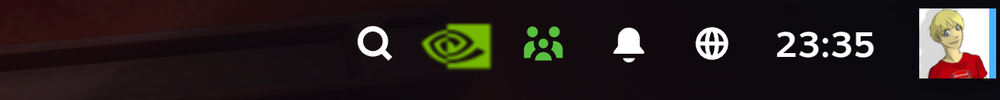
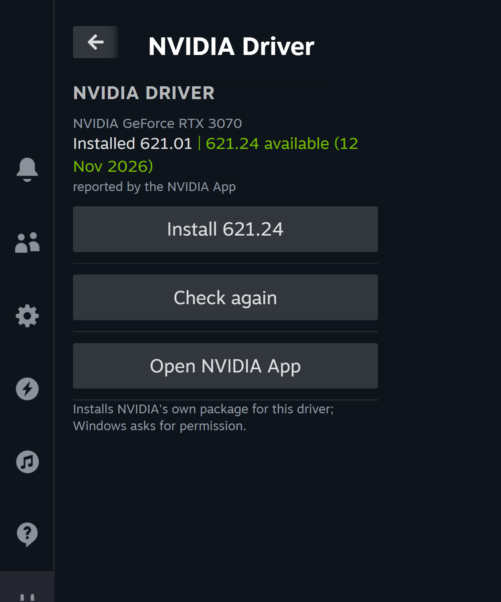

[English](README.md) · **Français**

# NVIDIA Driver

Un plugin Decky Loader pour Steam Big Picture : un badge dans la rangée d'icônes du haut quand
l'application NVIDIA a un pilote plus récent pour ce PC, et un panneau Decky qui l'installe.



## Installation

[](https://raw.githubusercontent.com/JamesDAdams/my-decky-plugins/main/releases/NvidiaDriver-decky-0.1.2.zip)

1. Téléchargez le zip ci-dessus.
2. Menu Decky (l'icône prise) → **Install from zip file** → `NvidiaDriver-decky-0.1.2.zip`.
3. Redémarrez Steam : le plugin et son backend Python démarrent avec le client.

Installation manuelle : décompressez pour que `homebrew/plugins/NvidiaDriver/` contienne `main.py`,
`plugin.json`, `dist/` et `tools/`, puis redémarrez Steam.

## Ce que l'on voit

- **Un badge dans la barre du haut**, juste avant le bouton de recherche, uniquement quand un pilote
  plus récent existe que celui rapporté par `nvidia-smi`. L'infobulle donne la version, par exemple
  *NVIDIA driver 621.24 available*.
- **Un clic ouvre le panneau Decky sur la page du plugin**, avec le GPU, la version installée et la
  recommandation datée.
- **Install <version>** télécharge le paquet officiel NVIDIA de ce pilote, le lance avec élévation
  (Windows demande l'autorisation) et affiche la progression dans le panneau : pourcentage du
  téléchargement, puis *Installing - the screen may go black for a minute*.
- **Check again** redemande à l'application NVIDIA ; **Open NVIDIA App** ramène sa fenêtre.



## D'où viennent les versions

- **Pilote installé** : `nvidia-smi --query-gpu=driver_version,name`.
- **Pilote recommandé** : le serveur MCP local de l'application NVIDIA, exposé par l'application sur
  `http://127.0.0.1:13508/mcp` (outil en lecture seule `nvapp_client_get_driver_status`). La réponse
  contient la version installée et chaque canal de recommandation avec `isUpdateAvailable`. Mesuré
  sur ce PC : installé `621.01`, recommandé `621.24`, `isUpdateAvailable: true`.
- **Repli** : quand l'application est fermée, son propre `console.log` est lu
  (`latestDispDriverVersion` et le `notification db state` du badge latéral), donc le badge survit à
  une application réduite dans la zone de notification qui a déjà vérifié.

## Comment se fait l'installation

L'application NVIDIA n'expose aucune commande d'installation sur ce serveur (ses outils sont en
lecture seule ou concernent les réglages de jeux), donc le plugin installe le paquet que
l'application recommande :

1. il résout l'URL exacte du `-g.exe` de la version recommandée et le télécharge dans
   `%LOCALAPPDATA%\NvidiaDriver\` (la progression est écrite dans `install-status.json`) ;
2. il lance le paquet avec les commutateurs silencieux de l'installeur (`-s -noreboot`) via
   `Start-Process -Verb RunAs` : Windows affiche sa propre demande UAC, le plugin ne demande jamais
   de mot de passe ;
3. il surveille `setup.exe` et `nvidia-smi` jusqu'à ce que le pilote rapporte la nouvelle version,
   puis indique s'il faut redémarrer Windows.

Le téléchargement et l'installation tournent dans `tools/install.ps1`, un helper détaché : un thread
en arrière-plan dans le bac à sable des plugins Decky a bloqué ce bac à sable sur cette machine (le
panneau ne répondait plus), alors qu'un processus séparé garde le panneau réactif et survit à un
redémarrage de Steam.

## Prérequis et limites

| Élément | Valeur |
| --- | --- |
| Système | Windows avec un GPU NVIDIA et l'application NVIDIA installée |
| Détection sans l'application | le journal de l'application, pour sa dernière vérification seulement |
| Autorisation | demande UAC au moment de l'installation (un pilote d'affichage l'exige) |
| Après l'installation | redémarrer Windows si l'installeur le demande ; le badge disparaît dès que `nvidia-smi` rapporte la nouvelle version |
| Badge de la barre du haut | souris uniquement, comme les icônes de la barre du haut de Steam ; le panneau Decky est entièrement navigable à la manette |
| Disque | environ 850 Mo pendant le téléchargement ; le paquet est supprimé après une installation réussie |

## Dépannage

| Symptôme | Cause et solution |
| --- | --- |
| Pas de badge | aucun pilote plus récent, ou l'application NVIDIA n'a jamais vérifié : ouvrez une fois sa page Drivers, puis *Check again* |
| *from the NVIDIA App's last check* | le serveur MCP local est éteint (application fermée ou réglage désactivé) ; la version vient quand même du journal de l'application |
| L'installation reste sur *Starting NVIDIA's installer* | la demande UAC a été refusée ou attend sur le bureau |
| L'installeur tourne mais la version ne change pas | redémarrer Windows ; `nvidia-smi` rapporte l'ancienne version tant que le pilote n'est pas actif |

## Vie privée

Aucun compte, nom ou chemin n'est codé en dur. Tout est lu depuis l'installation NVIDIA locale et
seuls deux réseaux sont utilisés : le serveur de l'application NVIDIA sur `127.0.0.1` et l'hôte de
téléchargement NVIDIA, avec l'URL que l'application liste elle-même.

## Développement

```powershell
npm install
npm run build          # dist/index.js, ASCII uniquement
npm test               # python -m unittest discover -s tests
python ../../tools/release.py package nvidia-driver --out-dir ../../releases
```

Structure : `main.py` (backend), `driverlogic.py` (aides pures, testées), `src/index.tsx` (entrée du
plugin), `src/topBar.ts` (injection du badge dans `Steam Big Picture Mode`), `src/ui/Panel.tsx` (le
panneau QAM), `src/decky.ts` (ouvre le panneau Decky sur ce plugin), `tools/install.ps1` (helper de
téléchargement/installation).

## Licence

MIT — voir [LICENSE](LICENSE).

Site : <https://jamesdadams.github.io/my-decky-plugins/#nvidia-driver>
