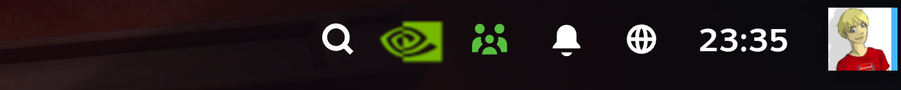
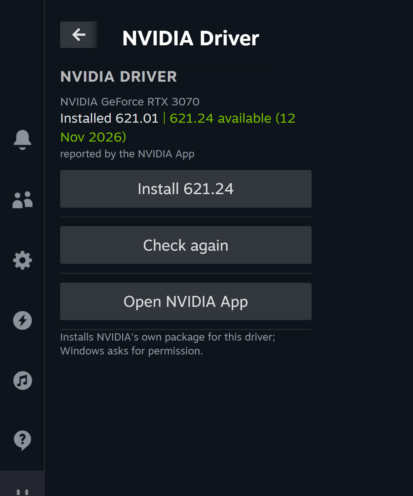

**English** · [Français](README.fr.md)

# NVIDIA Driver

A Decky Loader plugin for Steam Big Picture: a badge in the top icon row when the NVIDIA App has a
newer driver for this PC, and a Decky panel that installs it.



## Install

[](https://raw.githubusercontent.com/JamesDAdams/my-decky-plugins/main/releases/NvidiaDriver-decky-0.1.2.zip)

1. Download the zip above.
2. Decky menu (the plug icon) -> **Install from zip file** -> `NvidiaDriver-decky-0.1.2.zip`.
3. Restart Steam: the plugin and its Python backend start with the client.

Manual install: unzip so that `homebrew/plugins/NvidiaDriver/` holds `main.py`, `plugin.json`,
`dist/` and `tools/`, then restart Steam.

## What you see

- **A badge in the top bar**, right before the search button, only when a newer driver exists than
  the one `nvidia-smi` reports. The tooltip names the version, e.g. *NVIDIA driver 621.24 available*.
- **Clicking it opens the Decky panel on this plugin's page**, already showing the GPU, the installed
  version and the recommendation with its release date.
- **Install <version>** downloads NVIDIA's own package for that driver, starts it elevated (Windows
  asks for permission) and reports the progress in the panel: download percentage, then
  *Installing - the screen may go black for a minute*.
- **Check again** re-asks the NVIDIA App; **Open NVIDIA App** brings its window up.



## Where the versions come from

- **Installed driver**: `nvidia-smi --query-gpu=driver_version,name`.
- **Recommended driver**: the NVIDIA App's local MCP server, which the app itself exposes on
  `http://127.0.0.1:13508/mcp` (read-only tool `nvapp_client_get_driver_status`). The answer carries
  the installed version and every recommendation channel with `isUpdateAvailable`. Verified on this
  PC: installed `621.01`, recommended `621.24`, `isUpdateAvailable: true`.
- **Fallback**: when the app is closed, its own `console.log` is read (`latestDispDriverVersion` and
  the sidebar badge's `notification db state`), so the badge survives a tray-only app that has
  checked recently.

## How the install works

The NVIDIA App has no install command on that server (its tools are read-only or game settings), so
the plugin installs the package the app recommends:

1. it resolves the exact `-g.exe` URL for the recommended version and downloads it to
   `%LOCALAPPDATA%\NvidiaDriver\` (progress written to `install-status.json`);
2. it runs the package with the installer's silent switches (`-s -noreboot`) through
   `Start-Process -Verb RunAs`: Windows shows its own UAC prompt, the plugin never asks for a
   password;
3. it watches `setup.exe` and `nvidia-smi` until the driver reports the new version, then tells you
   to restart Windows if the installer asks for it.

The download and the install run in `tools/install.ps1`, a detached helper: a background thread
inside Decky's plugin sandbox wedged the sandbox on this machine (the panel stopped answering),
while a separate process keeps the panel responsive and survives a Steam restart.

## Requirements and limits

| Item | Value |
| --- | --- |
| System | Windows with an NVIDIA GPU and the NVIDIA App installed |
| Detection without the app | the app's log, for its last check only |
| Permission | UAC prompt at install time (a display driver install requires it) |
| After the install | restart Windows if the installer says so; the badge disappears once `nvidia-smi` reports the new version |
| Top bar badge | pointer only, like Steam's own top bar icons; the Decky panel is fully gamepad-navigable |
| Disk | about 850 MB during the download; the package is deleted after a successful install |

## Troubleshooting

| Symptom | Cause and fix |
| --- | --- |
| No badge | no newer driver, or the NVIDIA App never checked: open the app's Drivers page once, then *Check again* |
| *from the NVIDIA App's last check* | the local MCP server is off (app closed or its setting disabled); the version still comes from the app's log |
| The install stops at *Starting NVIDIA's installer* | the UAC prompt was refused or is waiting on the desktop |
| The installer runs but the version does not change | restart Windows; `nvidia-smi` reports the old version until the driver is active |

## Privacy

No account, name or path is hard-coded. Everything is read from the local NVIDIA install and only
two networks are used: the NVIDIA App's server on `127.0.0.1` and NVIDIA's download host, with the
URL the app itself lists.

## Development

```powershell
npm install
npm run build          # dist/index.js, ASCII only
npm test               # python -m unittest discover -s tests
python ../../tools/release.py package nvidia-driver --out-dir ../../releases
```

Layout: `main.py` (backend), `driverlogic.py` (pure helpers, unit-tested), `src/index.tsx` (plugin
entry), `src/topBar.ts` (badge injection into `Steam Big Picture Mode`), `src/ui/Panel.tsx` (the QAM
panel), `src/decky.ts` (opens the Decky panel on this plugin), `tools/install.ps1` (detached
downloader/installer).

## License

MIT - see [LICENSE](LICENSE).

Site: <https://jamesdadams.github.io/my-decky-plugins/#nvidia-driver>
