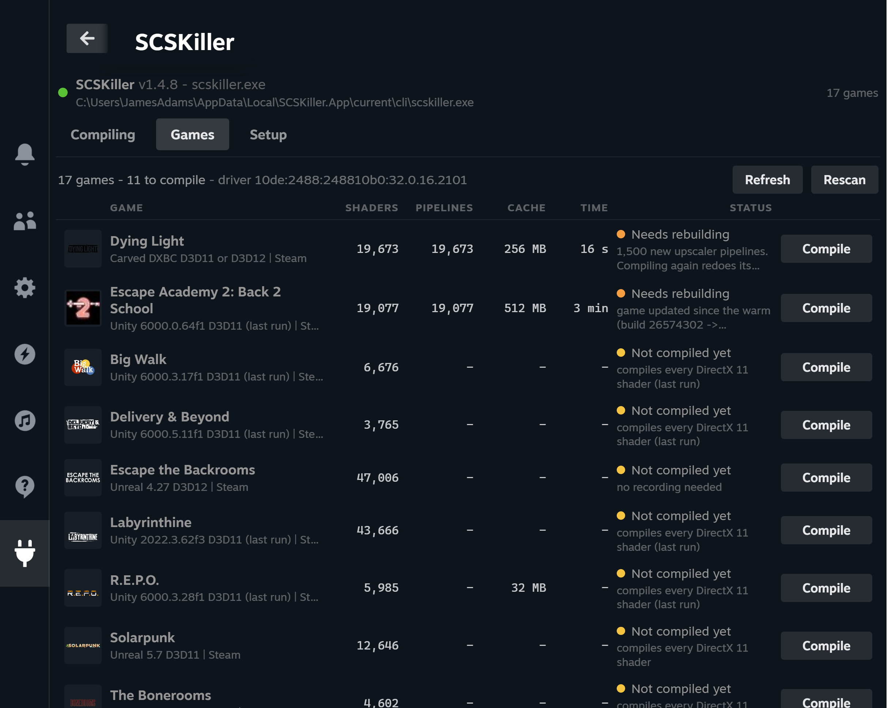

[English](README.md) · **Français**

# SCSKiller — plugin Decky Loader

Un plugin [Decky Loader](https://github.com/SteamDeckHomebrew/decky-loader) qui branche **SCSKiller**
(l'application Windows) sur l'interface Steam : sur la page d'un jeu, une ligne d'état SCSKiller et un
bouton **Compile** ; dans le menu d'accès rapide, un tableau de tous les jeux connus de SCSKiller.

[SCSKiller](https://github.com/BlueHeisenberg/SCSKiller) précompile les shaders d'un jeu dans le cache
du pilote GPU avant la partie, pour supprimer les saccades de compilation de shaders.

Le plugin **n'embarque rien de SCSKiller** (le paquet fait environ 50 Ko, aucun binaire) : il appelle
le `scskiller.exe` déjà installé sur la machine et lit le `games.json` que SCSKiller écrit. C'est un
pont, pas une copie.



## Installation

[](https://raw.githubusercontent.com/JamesDAdams/my-decky-plugins/main/releases/SCSKiller-decky-0.9.2.zip)

1. Téléchargez le zip (`SCSKiller-decky-0.9.2.zip`).
2. Decky Loader → icône engrenage → **Install from zip file** → sélectionnez ce zip.
3. Redémarrez Steam : Decky recharge le frontend du plugin, mais son backend Python ne démarre qu'au
   redémarrage de Steam.

Installation manuelle : copiez le dossier dans `~/homebrew/plugins/`
(`%USERPROFILE%\homebrew\plugins\` sous Windows), puis redémarrez Steam. Le dossier doit s'appeler
`SCSKiller`, le `name` de `plugin.json`.

## Ce qu'il fait

**Sur la page d'un jeu**, un bouton **fabriqué à partir de l'icône native de Steam** (48x48 px, coins
à 2 px, fond `rgba(172,178,201,0.14)`), **dans la rangée d'icônes, immédiatement à gauche de l'icône
manette**, avec le badge SCSKiller et une pastille verte (compilé) ou rouge (à compiler).

> Comment : le JavaScript des plugins Decky tourne dans le contexte JS partagé de Steam, une page de
> 1x1 px qui ne peut pas interroger le DOM visible. Le bouton est dessiné dans **sa propre couche
> fixe** ajoutée à `document.body` (jamais dans une rangée rendue par Steam, ce qui casserait la
> réconciliation React de cette rangée) et positionné d'après le rectangle de l'icône manette. Il
> reçoit un **nœud de navigation dans le groupe de focus de la rangée**, copié de l'icône `Manage` de
> cette rangée, en retirant les deux propriétés qui répondent pour le *mauvais* élément
> (`fnCanTakeFocus`, `childFocusDisabled`) : mesuré, un nœud copié qui les garde affiche
> `GetFocusable() = "none"` et la manette passe à côté.

Un clic dessus ouvre une **fenêtre de stats**, avec les chiffres que SCSKiller affiche lui-même :

- statut et raison (`Warmed`, `Needs rebuilding`, `Needs a recording`...) ;
- **Shaders**, **Pipelines** (enregistrés + générés + middleware), **Cache** sur disque et utilisé ;
- **Estimation** (taille et durée), **dernière compilation** (date, durée, pilote) ;
- couverture, moteur/API, recorder, nouveaux pipelines, stutter connu ;
- boutons **Compile** / **Stop** / **Refresh** / **Close** (le log de compilation s'affiche pendant le
  travail).

Si Steam change sa mise en page, le panneau Decky affiche une ligne `Game page:` qui dit exactement ce
qui s'est passé (`button drawn in the icon row`, `button inserted in the icon row with its own navigation node`, `no controller icon on this page`, ...). Rien n'est jamais
ajouté à un endroit approximatif.

### Si le bouton n'apparaît pas du tout

Vérifiez dans cet ordre :

1. **Le plugin est-il activé ?** Steam → Paramètres → Decky → Plugins : la ligne `SCSKiller` doit être
   présente et activée. Un plugin désactivé n'est jamais chargé (aucun bundle, aucune erreur visible).
2. **Le backend Decky connaît-il le plugin ?** Si le dossier a été copié pendant que Decky tournait, la
   liste des plugins peut être restée vide et toutes les requêtes échouent en `KeyError` / HTTP 500.
   Redémarrez Decky (ou Steam et le service Decky) pour qu'il rescanne `homebrew/plugins`.
3. Les journaux : `~/homebrew/logs/SCSKiller/` doit contenir un fichier récent avec
   `plugin loaded; settings: ...` et `detection: ...`.

**Dans le panneau Decky** (bouton `...`) — deux onglets, **Games** et **Setup**, contenu calé sur la
largeur réellement accordée par le menu :

La bande visible du menu fait **348 px**, mais elle *inclut* le rail d'icônes de Steam (48 px) : le
panneau ne peut donc faire que **300 px** (c'est exactement le plafond de Steam). Élargir le panneau
au-delà pousse les colonnes hors écran (mesuré : la fenêtre du menu est posée à 1005 px sur un écran de
1353 px). Le plugin garde donc 300 px et **réserve environ 70 px de marge à droite** (les
launchers/streams recadrent le bord droit du menu), ce qui laisse 224 px utiles : tout est calé dedans,
vérifié dans le DOM (`scrollWidth === clientWidth`, aucun débordement). Là où le panneau est vraiment
plus large (620 px et plus), les jeux s'affichent en tableau — **GAME**, **SHADERS**, **PIPELINES**,
**CACHE**, **TIME**, **STATUS** ; en dessous, ils se replient en lignes compactes : logo, pastille de
statut à gauche du nom, nom complet (deux lignes si besoin), taille du cache et temps estimé (toujours
préfixé par `~`), et un bouton **Compile**.

Élargir la fenêtre du menu est impossible depuis un plugin (testé ici) : `window.moveTo` s'exécute bien
dans la fenêtre du menu (`executeInTab` répond `left=500`) mais **Steam la replace aussitôt**, et
`MenuStore.RequestExtendSideMenuVisibility()` n'incrémente qu'un compteur de visibilité, pas une
largeur.

- **Games** : une ligne de compteur (`17 games - 11 to compile`), **un seul** bouton **Refresh** (il
  relance `scskiller status` et relit les chiffres) et, dessous, la **légende des pastilles**
  (`Warmed`, `Needs rebuild`, `Not compiled`, `Partial`, `Needs 5m recording`, `Blocked`). Chaque jeu :
  logo, **pastille de statut à gauche du nom**, nom complet (deux lignes si besoin), puis la
  **taille du cache** et le **temps estimé** (toujours préfixé par `~`), et un bouton **Compile** par
  ligne. Le bouton est **grisé** pour les jeux `Warmed` (rien à compiler) et `Needs 5m recording`
  (SCSKiller attend d'abord un enregistrement de 5 min) ; il affiche `Blocked` pour les jeux non
  supportés. Les valeurs inconnues sont omises. Clic (ou A) sur une ligne : la fenêtre de stats.
- **Compilations en cours** : elles n'ont plus d'onglet à elles. Leur nombre est un badge sur le
  libellé de l'onglet **Games**, et la liste elle-même (jeu, étape, durée, dernières lignes, bouton
  **Stop**), avec les compilations terminées, vit sur la page SCSKiller plein écran décrite plus bas.
- **Onglets** : `Games` et `Setup` sont de vrais éléments focalisables (anneau de focus visible), donc
  la manette peut s'y déplacer et **A** active l'onglet.
- **Manette** : le panneau Decky navigue **verticalement** — `bas`/`haut` passent d'un élément au
  suivant (onglets, Refresh, ligne de jeu, bouton Compile), `gauche`/`droite` sortent vers le rail
  d'icônes. C'est pourquoi chaque ligne et son bouton **Compile** sont deux éléments distincts : **A**
  sur la ligne ouvre les stats, `bas` passe sur le bouton, **A** compile. La fenêtre de stats se
  parcourt aussi avec `bas`/`haut` (Refresh, Compile, Close). Une ligne de rappel est affichée sous la
  liste.
- **Setup** : détection du `scskiller.exe` et de `SCSKiller.exe` (version, chemins), bouton
  **Open SCSKiller**, chemin manuel, diagnostics de la page de jeu (copiables), et les réglages de
  compilation (threads, priorité arrière-plan `--idle`, rafraîchissement auto de la page).

L'ancienne section « Options » n'existe plus : ses trois réglages sont dans l'onglet **Setup**.

## Ce qu'il ne fait pas

- Il ne télécharge, n'installe et **ne modifie pas** SCSKiller : celui-ci doit déjà être installé.
- Il ne remplace pas l'interface de SCSKiller : pour les clés de jeux chiffrés, les sessions de
  recorder, le *before/after* ou les réglages fins, le bouton **Open SCSKiller** ouvre l'app.
- L'affichage sur la page d'un jeu passe par l'API de *route patching* de Decky, qui n'est pas une API
  officielle de Valve : une mise à jour du client Steam peut casser cette ligne. Tout échoue en
  silence (la page reste intacte) et le panneau Decky continue de fonctionner.

## Prérequis

| Élément | Détail |
|---|---|
| SCSKiller | installé sur Windows (`SCSKiller-Setup.exe` ou portable), lancé au moins une fois |
| Decky Loader | avec le backend Python qui tourne sur la même machine que Steam |
| Steam | « Shader Pre-caching » activé (SCSKiller le recommande) |
| GPU | NVIDIA ou AMD, DirectX 12 (DirectX 11 sur NVIDIA) |

## Détection automatique

Emplacements cherchés, dans l'ordre :

| Chemin | Cas |
|---|---|
| `%LOCALAPPDATA%\SCSKiller.App\current\cli\scskiller.exe` | installation par `SCSKiller-Setup.exe` (Velopack) |
| `%LOCALAPPDATA%\SCSKiller\current\cli\scskiller.exe` | anciennes installations / portables |
| `%LOCALAPPDATA%\Programs\SCSKiller\current\cli\scskiller.exe` | variante Velopack |
| `scskiller.exe` dans le `PATH` | ajout manuel |
| le chemin saisi dans le panneau | n'importe où |

L'état est lu dans `%LOCALAPPDATA%\SCSKiller\games.json` (ou `<portable>\data\games.json`), et la
fenêtre `SCSKiller.exe` est cherchée au même endroit que la CLI.

Rien n'est trouvé ? Le panneau affiche le chemin attendu et un champ pour le saisir à la main :
`...\SCSKiller.App\current\cli\scskiller.exe`.

## Compiler depuis les sources

```bash
cd scskiller-decky
pnpm install      # ou npm install
pnpm build        # produit dist/index.js
```

Le backend (`main.py`) n'a **aucune dépendance Python** : bibliothèque standard + module `decky`
fourni par le loader.

## Page SCSKiller (Big Picture)

Le plugin enregistre une **page plein écran** sur la route `/scskiller`, calquée sur la page
Téléchargements de Steam : titre, sections **In progress** / **Queue** / **Finished**, capsule du jeu,
ligne d'étape et barre de progression (extraite des lignes `1274/21449` du CLI), boutons **Stop** (en
cours) et **Remove** (file d'attente).

- **File d'attente** : `start_compile` ne refuse plus un second jeu, il l'empile (`_queue` dans
  `main.py`) et `_drain_queue` lance le suivant quand le CLI en cours se termine. `get_compiles`
  renvoie `queue: [{app_id, position}]`, plus `cancel_queued(app_id)` et `clear_queue()`. Chaque ligne
  de la file a un bouton **Start** (`start_queued(app_id)`) qui la fait passer tout de suite en
  *In progress* (grisé tant qu'une compilation tourne) et un bouton **Remove**. Le drainage se fait
  dans une tâche séparée (`_drain_after`) : il tournait avant sur la tâche de compilation en train de
  finir, donc `_compile_task.done()` était encore faux et la file restait **bloquée pour toujours** —
  y compris après un **Stop** (qui saute la fin de `_run_compile`).
- **Pastille de statut** : elle se rafraîchit dès qu'une compilation se termine. `index.tsx` écoute
  `scsk_compile_done` et appelle `get_status(appid, true)` → `setStatus`, donc le point de la page du
  jeu, des lignes du panneau et du badge change de couleur sans quitter la page ; `ScskButton` fait la
  même chose en secours quand son polling voit `running` passer de vrai à faux.
- **Icône en haut à droite** (composant global, comme le badge de téléchargement) : elle n'apparaît
  **que pendant une compilation** (`display: none` sinon) et montre alors la capsule du jeu + une
  **mini barre de progression** ; un clic ouvre la page. **En pause**, un glyphe pause (20x20, fond
  `rgba(0,0,0,0.62)`, deux barres blanches) est dessiné **par-dessus le logo du jeu** et la mini-barre
  passe en gris. Hors compilation, la page s'ouvre par l'entrée du menu de gauche.
- **Champ de recherche de Steam** : à l'ouverture de la page, Steam donne le focus à sa barre de
  recherche (elle apparaît blanche et sélectionnée) parce que la route n'a rien de focalisable. Le
  composant pousse ce focus dehors : un `div` d'ancrage `tabIndex=0` prend le focus, et un watchdog
  appelle `executeInTab("Steam Big Picture Mode", ...)` toutes les 200 ms pendant 12 s pour `blur()`
  tout `input`/`textarea`/`searchbox` actif — **dans la fenêtre Big Picture**, pas dans le document
  1x1 px du plugin, où `document.activeElement` ne voit pas ce champ. Le premier clic ou la première
  touche de l'utilisateur arrête le watchdog. Vérifié : `document.activeElement` = `BODY` après
  ouverture.
- **Pause** : `NtSuspendProcess` / `NtResumeProcess` (les deux appels étaient **inversés** : « Pause »
  réveillait le processus, le pourcentage continuait de monter pendant que l'interface affichait
  « pause »). Vérifié : CPU figé (delta 0 s sur 4 s) et pourcentage constant.
- **Lancer un jeu met la compilation en pause** : `SteamUIStore.m_runningAppIDs` (visible depuis le
  contexte JS du plugin) passe de vide à non vide → `pause_compile()` une fois par lancement, avec une
  ligne de log. Un `Resume` manuel n'est pas écrasé tant que le jeu tourne.
- **Pendant une compilation, la page du jeu** : le bouton **Play** devient **Pause**, un bouton
  **Cancel** apparaît juste après lui, puis la colonne **`COMPILING`**, puis `LAST PLAYED` /
  `PLAY TIME` (les deux stats natives restent visibles, simplement poussées à droite). Le bouton garde
  exactement la boîte de Steam (`rgba(220,222,223,0.17)`, hover `0.26`, radius 2px) : seuls le glyphe
  (24 px à `x+16`) et le libellé (`x+56`, 16px/500 blanc) sont remplacés, le reste est l'élément natif.
  **Cancel** est une icône d'action Steam (48x48, `rgba(172,178,201,0.14)`, hover `0.26`) : un clic
  incrémente `window.__scskCancelClicks`, le plugin le lit toutes les 250 ms et appelle
  `cancel_compile()` — y compris quand la compilation est en pause (le CLI suspendu est d'abord
  réveillé, sinon `CTRL_BREAK` resterait en attente jusqu'au `taskkill`). La colonne reprend les
  métriques mesurées de Steam — libellé 12px/700, `letter-spacing 0.5px`, `text-transform: uppercase`,
  `rgba(255,255,255,0.7)`, `line-height 22px` ; valeur 16px/500 blanche, `line-height 20px` — plus une
  barre de 3 px dont la largeur est **celle du texte du pourcentage** (mesurée après le rendu, environ
  113 px), pas celle de la colonne : une barre large se lisait comme une barre de page entière. Mesuré
  en direct : bouton `[38, 367, 210, 48]`, cancel **collé** `[248, 367, 48, 48]`, colonne
  `[312, 368, 160, 47]`, `LAST PLAYED` `492`, `PLAY TIME` `596` (le bloc stats reçoit un `margin-left`
  calculé depuis sa position **non décalée**, sinon le décalage oscillait, et il est remis à zéro en
  fin de compilation). Le fond du bouton est figé en inline (`rgba(220,222,223,0.17)`) et l'enfant qui
  le peint est masqué : sans ça, le focus manette de Steam le repeignait en vert (`rgb(89,191,64)`). Le
  bouton **SCSKiller** de la rangée d'icônes, lui, **ne change jamais d'icône** : il ouvre toujours la
  fiche. Tout cela n'apparaît que sur la page du jeu **qui compile** : l'appid affiché est lu dans la
  chaîne de fibres React de la barre de lecture (`memoizedProps.overview.appid`), car
  `location.pathname` reste `/index.html` dans la fenêtre Big Picture.
- **Toast de fin** : non critique (un toast `critical` ouvre une modale Big Picture qui rend la page
  inerte jusqu'à sa fermeture). Il affiche le **nom du jeu** et son **logo**, pas l'identifiant
  `steam:381210` : le nom vient de `get_status(appid, true)` (le même appel qui rafraîchit la
  pastille), et le logo est inséré dans le toast lui-même (`apps/<appid>/logo.png`, 28x28) parce que
  le toast de Decky n'a pas de champ image — son champ `icon` n'accepte que du texte. Le toast vit dans
  sa propre fenêtre CEF **`notificationtoasts_uid<N>`** (classe `.DeckyGamepadUIPopupToast`) : le logo
  est ajouté via `executeInTab` (comme l'icône du menu), avec des tentatives répétées pendant environ
  5 s car le toast s'affiche après coup ; il est posé devant le titre, là où le toast sans icône n'a
  qu'une ligne de texte.
- **Entrée dans le menu de gauche** : le menu (Home / Library / Store / ... / Downloads / Settings /
  Power) n'est **pas** dans la fenêtre Big Picture — il vit dans sa propre fenêtre CEF
  **`MainMenu_uid<N>`** (241x762, le N change à chaque démarrage de Steam). La liste est gérée par
  React et n'est pas exposée à `routerHook`, donc le plugin **clone l'item « Downloads »** dans cette
  fenêtre, le renomme `SCSKiller` et l'insère juste après ; un clic incrémente un compteur que le
  plugin lit (polling `executeInTab`) et qui déclenche `history.pushState("/scskiller")` + `popstate`.
  Vérifié : `menu: entry injected under Downloads` puis clic → la page s'ouvre. Le clic est lu toutes
  les 250 ms (les deux badges renvoient un compteur via un `executeInTab`) et `openPage` ferme les
  menus latéraux Steam (`MenuStore.CloseSideMenus`) avant de pousser la route : la page s'affiche en
  environ 60 ms et le menu de gauche se referme.
- La page se testait via l'historique du routeur : `history.pushState({}, "", "/scskiller")` puis un
  `popstate` — c'est exactement ce que fait l'icône.

- **Finished** : les compilations terminées de la session, avec la date à droite (`COMPLETED: ...`) et
  un bouton **Clear All** dès qu'il y en a au moins une (même place que sur la page Téléchargements) ;
  il appelle `clear_finished()`, qui oublie les compilations finies sans toucher à celle en cours ni à
  la file d'attente.
- **Pourquoi une compilation du plugin n'apparaît pas dans la fenêtre SCSKiller** : le plugin lance
  `scskiller.exe compile <jeu>` comme **processus CLI séparé**, alors que la page « Compile queue » de
  l'application est sa propre file, alimentée par « Add to queue » dans l'app. Le shell
  `scskiller queue` existe (`list | add | start | stop`) mais répond `queue not running` hors session
  de l'app : on ne peut pas y injecter depuis l'extérieur. La page du plugin est donc la vue de
  référence pour les compilations qu'il lance.

## Dépannage

| Symptôme | Cause / solution |
|---|---|
| « SCSKiller was not found » | l'app n'est pas installée, ou est dans un dossier non standard : saisissez le chemin de `scskiller.exe` dans le panneau |
| Le chemin `...\current\cli\scskiller.exe` n'existe pas | installation incomplète ou très ancienne : réinstallez SCSKiller (le dossier `cli` fait partie du paquet) |
| Statut « Unavailable » | la CLI a renvoyé une erreur ; testez-la : `%LOCALAPPDATA%\SCSKiller.App\current\cli\scskiller.exe status steam:620` |
| Compile refusé « close the game first » | SCSKiller compile jeu fermé |
| « Needs a recording » | SCSKiller n'a pas les pipelines de ce jeu : activez le recorder dans l'app, jouez quelques minutes, puis compilez |
| Rien sur la page du jeu | le client Steam a changé : passez par le panneau Decky |
| Une fenêtre noire clignote à l'ouverture d'une page de jeu / de l'onglet Setup | c'était le CLI console lancé sans masque : tous les lancements passent maintenant par `CREATE_NO_WINDOW` + `STARTUPINFO`/`SW_HIDE` (`_NO_WINDOW` dans `main.py`) — si ça revient, c'est un nouveau `subprocess` ajouté sans ces options |

Journaux : `~/homebrew/logs/SCSKiller/` (Decky) et `%LOCALAPPDATA%\SCSKiller\app.log` (SCSKiller).

## Comment ça marche

```
src/index.tsx            definePlugin : panneau + écouteurs d'événements
src/gamePageTree.tsx     place le bouton dans la rangée d'icônes : copie de l'icône native `Manage`
                         plus copie de son nœud de navigation manette, revérifié toutes les 400 ms
src/ui/ScskButton.tsx    état partagé (quel jeu la page affiche) + ouverture de la fenêtre
src/ui/ScskModal.tsx     la fenêtre de stats + Compile/Stop/Refresh
src/ui/ScskIcon.tsx      le badge (éclair dans un hexagone)
src/ui/Panel.tsx         panneau Decky (détection, liste, réglages, log)
src/store.ts             état partagé (statuts, compilations) hors composants
src/diagnostics.ts       état d'injection lu par le panneau (ligne « Game page: »)
main.py                  backend : détection, lecture de games.json, CLI, compile
tests/                   tests des parseurs + intégration avec un faux SCSKiller
tools/                   scripts CDP (eval, reload, click, key, shot) pour vérifier en direct
build.ps1                typecheck + build + contrôle ASCII + tests + install + zip
```

Pourquoi le bouton vit dans sa propre couche avec un nœud copié : le JavaScript du plugin tourne dans le
contexte partagé de Steam, une page de 1x1 px qui ne peut pas interroger le DOM visible, et Big Picture
déplace le focus manette à travers les **nœuds de navigation** que Steam enregistre pour ses propres
composants `Focusable`. Un élément React inséré par un patch de route a la bonne apparence, mais son
nœud tombe sous le conteneur de page (vérifié : parent `_1SvpjsckP9cPRxO6gCBHrw` au lieu de la rangée
d'icônes `_1thLDT_28YIf6OkgIb6n-4`), et la manette passe à côté. Ajouter du balisage *dans* la rangée est
pire : c'est une liste d'enfants React, la réconciliation suivante de l'arbre Steam peut déplacer ou
perdre des éléments et toute la rangée devient inatteignable (mesuré : après une telle insertion, aucune
des trois icônes n'était focusable depuis Play). Le bouton est donc dessiné hors des conteneurs Steam,
dans une couche fixe, au rectangle de l'icône manette moins sa propre largeur et l'écart de 10 px, et
seul son **nœud** rejoint le groupe de focus de la rangée : une copie du nœud de l'icône `Manage` de
cette rangée, sans `fnCanTakeFocus` ni `childFocusDisabled`, car un nœud copié qui les garde répond pour
l'*autre* élément et affiche `GetFocusable() = "none"`.

Côté backend :

- **statut rapide** : lecture de `games.json`, que SCSKiller réécrit après chaque scan (aucun processus
  lancé) — shaders, pipelines, cache, durées et dates viennent de ce fichier, comme dans l'app ;
- **statut de secours** : `scskiller.exe status steam:<appid>` puis analyse des lignes `clé valeur` ;
- **compilation** : `scskiller.exe compile steam:<appid> [--threads N] [--idle]`, stdout lu ligne à
  ligne et poussé au frontend par `decky.emit` (`scsk_compile_started`, `scsk_compile_line`,
  `scsk_compile_done`) ;
- **Stop** : `CTRL_BREAK` (le CLI de SCSKiller traite `Console.CancelKeyPress`), avec
  `taskkill /T /F` en secours.

## Tests

```bash
python -m unittest discover -s tests -v
```

Les tests n'ont besoin ni de Decky ni de SCSKiller : parseurs, détection du `scskiller.exe` d'une
installation Windows, lecture de `games.json`, refus quand le jeu tourne, streaming de progression,
échecs et annulation.

## Autres plateformes

Le même code fonctionne sur SteamOS/Linux si SCSKiller y est installé en AppImage
(`SCSKiller-x86_64.AppImage --cli ...`), mais ce n'est pas le cas d'usage de ce dépôt : sous Windows,
SCSKiller est une application normale et le plugin se contente de la lancer.

## Développement

Le code source vit dans le workshop Decky : `decky/plugins/scskiller/` (à côté de `decky/AGENTS.md` et
des skills). Il se construit, s'installe et se package en une commande :

```powershell
powershell -ExecutionPolicy Bypass -File .\build.ps1
```

Le script enchaîne : `tsc --noEmit`, build rollup, **contrôle ASCII du bundle** (Decky sert le module
sans charset : un seul caractère accentué s'affiche `â€"` dans l'UI), tests, copie dans
`%USERPROFILE%\homebrew\plugins\SCSKiller`, puis zip dans `releases/` avec des entrées en `/`
(`Compress-Archive` écrit des `\`, que l'installeur Decky ne sait pas extraire).

Après une modification de `main.py`, **redémarrez Steam** : Decky ne recharge pas le processus Python
sur `unloadPlugin`/`importPlugin`/`restartWebhelper`.

## Licence et crédits

MIT (voir `LICENSE`). Plugin non affilié à SCSKiller ni à Valve. SCSKiller est distribué sous
GPL-3.0-or-later par BlueHeisenberg ; ce plugin ne fait que l'exécuter.
