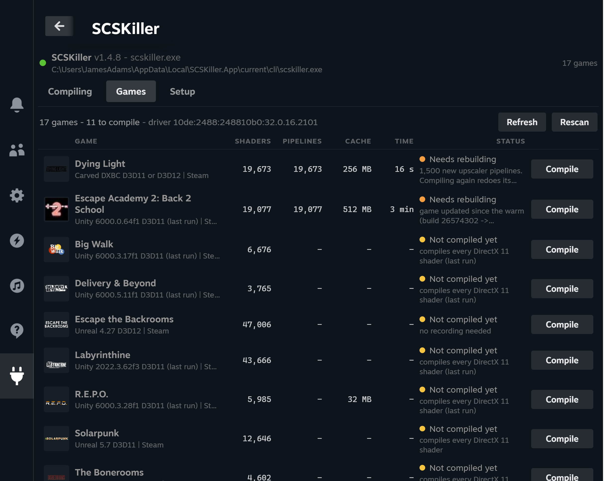

**English** · [Français](README.fr.md)

# SCSKiller

A [Decky Loader](https://github.com/SteamDeckHomebrew/decky-loader) plugin that plugs **SCSKiller**
(the Windows application) into the Steam interface: a game's page gets an SCSKiller status line and a
**Compile** button, and the Quick Access Menu gets a table of every game SCSKiller knows about.

[SCSKiller](https://github.com/BlueHeisenberg/SCSKiller) precompiles a game's shaders into the GPU
driver cache before the session, which removes shader-compilation stutter.

The plugin ships **nothing from SCSKiller** (the package is about 50 KB, with no binaries): it calls
the `scskiller.exe` already installed on the machine and reads the `games.json` SCSKiller writes. It
is a bridge, not a copy.



## Install

[](https://raw.githubusercontent.com/JamesDAdams/my-decky-plugins/main/releases/SCSKiller-decky-0.8.2.zip)

1. Download the zip (`SCSKiller-decky-0.8.2.zip`).
2. Decky Loader -> gear icon -> **Install from zip file** -> select that zip.
3. Restart Steam: Decky reloads the plugin's frontend, but its Python backend only starts on a Steam
   restart.

Manual install: copy the folder into `~/homebrew/plugins/` (`%USERPROFILE%\homebrew\plugins\` on
Windows), then restart Steam. The folder must be named `SCSKiller`, the `name` in `plugin.json`.

## What it does

**On a game's page**, a **button identical to Steam's native icons** (48x48 px, 2 px corners,
`rgba(172,178,201,0.14)` background), **immediately left of the controller icon** (8 px gap, centres
aligned), with the SCSKiller badge and a green dot (compiled) or a red dot (to compile).

> How: Decky plugin JavaScript runs in Steam's shared JS context, a 1x1 px page with no access to the
> visible DOM. The button is therefore inserted into the route's React tree (between the artwork
> header and the play bar) and positioned absolutely (`right: 152px`, `top: 16px`) so that it falls
> exactly in front of the controller icon, which is anchored to the right end of that bar.

A click opens a **stats window** with the numbers SCSKiller itself displays:

- status and reason (`Warmed`, `Needs rebuilding`, `Needs a recording`...);
- **Shaders**, **Pipelines** (recorded + generated + middleware), **Cache** on disk and in use;
- **Estimated** (size and duration), **Last compile** (date, duration, driver);
- coverage, engine/API, recorder, new pipelines, known stutter;
- **Compile** / **Stop** / **Refresh** / **Close** buttons (the compile log shows while it runs).

If Steam changes its layout, the Decky panel shows a `Game page:` line that says exactly what
happened (`button injected under the Play bar`, `no content container`, ...). Nothing is ever added in
an approximate place.

### If the button does not appear at all

Check in this order:

1. **Is the plugin enabled?** Steam -> Settings -> Decky -> Plugins: the `SCSKiller` row must be there
   and enabled. A disabled plugin is never loaded (no bundle, no visible error).
2. **Does the Decky backend know the plugin?** If the folder was copied while Decky was running, the
   plugin list can still be empty and every request fails with `KeyError` / HTTP 500. Restart Decky
   (or Steam and the Decky service) so that it rescans `homebrew/plugins`.
3. The logs: `~/homebrew/logs/SCSKiller/` must hold a recent file with `plugin loaded; settings: ...`
   and `detection: ...`.

**In the Decky panel** (the `...` button) - two tabs, **Games** and **Setup**, with the content fitted
to the width the menu actually gives:

The menu's visible strip is **348 px**, but it *includes* Steam's 48 px icon rail: the panel can
therefore only be **300 px** (Steam's own cap). Widening the panel beyond that pushes the columns off
screen (measured: the menu window sits at 1005 px on a 1353 px screen). The plugin keeps 300 px and
**reserves about 70 px of right margin** (launchers and streams crop the right edge of the menu),
which leaves 224 usable px: everything is fitted inside it, verified in the DOM
(`scrollWidth === clientWidth`, no overflow). Where the panel is genuinely wider (620 px and up) the
games are laid out as a table - **GAME**, **SHADERS**, **PIPELINES**, **CACHE**, **TIME**, **STATUS**;
below that they fold into compact rows: logo, status dot left of the name, full name (two lines if
needed), cache size and estimated time (always prefixed with `~`), plus a **Compile** button.

Widening the menu window itself is impossible from a plugin (tested here): `window.moveTo` does run in
the menu window (`executeInTab` answers `left=500`) but **Steam puts it straight back**, and
`MenuStore.RequestExtendSideMenuVisibility()` only increments a visibility counter, not a width.

- **Games**: a counter line (`17 games - 11 to compile`), **one** **Refresh** button (it reruns
  `scskiller status` and re-reads the numbers) and, below it, the **dot legend** (`Warmed`,
  `Needs rebuild`, `Not compiled`, `Partial`, `Needs 5m recording`, `Blocked`). Each game: logo,
  **status dot left of the name**, full name (two lines if needed), then the **cache size** and the
  **estimated time** (always prefixed with `~`), plus a **Compile** button per row. The button is
  **greyed out** for `Warmed` games (nothing to compile) and for `Needs 5m recording` ones (SCSKiller
  waits for a 5-minute recording first); it shows `Blocked` for unsupported games. Unknown values are
  omitted. Click (or A) on a row: the stats window.
- **Compiles in progress**: they are no longer a tab of their own. Their count is a badge on the
  **Games** tab label, and the list itself (game, step, duration, last lines, **Stop** button), with
  the finished compiles, lives on the full SCSKiller page described below.
- **Tabs**: `Games` and `Setup` are real focusable elements (with a visible focus ring), so the
  controller can move onto them and **A** activates the tab.
- **Controller**: the Decky panel navigates **vertically** - `down`/`up` walk from one element to the
  next (tabs, Refresh, game row, Compile button) and `left`/`right` leave towards the icon rail. That
  is why each row and its **Compile** button are two distinct elements: **A** on the row opens the
  stats, `down` moves onto the button, **A** compiles. The stats window is walked the same way
  (Refresh, Compile, Close). A reminder line is shown under the list.
- **Setup**: detection of `scskiller.exe` and `SCSKiller.exe` (version, paths), an **Open SCSKiller**
  button, the manual path, the game-page diagnostics (copyable), and the compile settings (threads,
  `--idle` background priority, game page auto-refresh).

The old **Options** section is gone: its three settings now live in the **Setup** tab.

## What it does not do

- It does not download, install or **modify** SCSKiller: that application must already be installed.
- It does not replace SCSKiller's interface: for encrypted game keys, recorder sessions, the
  *before/after* view or fine-grained settings, the **Open SCSKiller** button opens the app.
- Showing anything on a game's page relies on Decky's *route patching* API, which is not an official
  Valve API: a Steam client update can break that line. Everything fails silently (the page stays
  intact) and the Decky panel keeps working.

## Requirements

| Item | Detail |
|---|---|
| SCSKiller | installed on Windows (`SCSKiller-Setup.exe` or portable), started at least once |
| Decky Loader | with its Python backend running on the same machine as Steam |
| Steam | "Shader Pre-caching" enabled (SCSKiller recommends it) |
| GPU | NVIDIA or AMD, DirectX 12 (DirectX 11 on NVIDIA) |

## Automatic detection

Locations searched, in order:

| Path | Case |
|---|---|
| `%LOCALAPPDATA%\SCSKiller.App\current\cli\scskiller.exe` | install from `SCSKiller-Setup.exe` (Velopack) |
| `%LOCALAPPDATA%\SCSKiller\current\cli\scskiller.exe` | older installs / portable ones |
| `%LOCALAPPDATA%\Programs\SCSKiller\current\cli\scskiller.exe` | Velopack variant |
| `scskiller.exe` on the `PATH` | added by hand |
| the path typed in the panel | anywhere |

The state is read from `%LOCALAPPDATA%\SCSKiller\games.json` (or `<portable>\data\games.json`), and
the `SCSKiller.exe` window is looked for next to the CLI.

Nothing found? The panel shows the expected path and a field to type it by hand:
`...\SCSKiller.App\current\cli\scskiller.exe`.

## Build from source

```bash
cd scskiller-decky
pnpm install      # or npm install
pnpm build        # produces dist/index.js
```

The backend (`main.py`) has **no Python dependency**: standard library plus the `decky` module
provided by the loader.

## SCSKiller page (Big Picture)

The plugin registers a **full-screen page** on the `/scskiller` route, modelled on Steam's Downloads
page: title, **In progress** / **Queue** / **Finished** sections, the game's capsule, a step line and a
progress bar (extracted from the CLI's `1274/21449` lines), **Stop** (running) and **Remove** (queued)
buttons.

- **Queue**: `start_compile` no longer refuses a second game, it stacks it (`_queue` in `main.py`) and
  `_drain_queue` starts the next one when the current CLI finishes. `get_compiles` returns
  `queue: [{app_id, position}]`, plus `cancel_queued(app_id)` and `clear_queue()`. Each queue row has a
  **Start** button (`start_queued(app_id)`) that moves it straight to *In progress* (greyed out while a
  compile runs) and a **Remove** button. Draining happens in a separate task (`_drain_after`): it used
  to run on the task of the compile that was ending, so `_compile_task.done()` was still false and the
  queue stayed **blocked forever**, including after a **Stop** (which skips the end of
  `_run_compile`).
- **Status dot**: it refreshes as soon as a compile ends. `index.tsx` listens for `scsk_compile_done`
  and calls `get_status(appid, true)` -> `setStatus`, so the dot on the game page, in the QAM rows and
  in the badge changes colour without leaving the page; `ScskButton` does the same as a fallback when
  its polling sees `running` go from true to false.
- **Top-right icon** (a global component, like Steam's download badge): it appears **only during a
  compile** (`display: none` otherwise) and then shows the game's capsule plus a **mini progress bar**;
  a click opens the page. **While paused**, a pause glyph (20x20, `rgba(0,0,0,0.62)` background, two
  white bars) is drawn **over the game's logo** and the mini bar turns grey. Outside a compile, the
  page is opened from the left menu entry.
- **Steam search field**: when the page opens, Steam gives the focus to its search bar (it turns white
  and selected) because the route has nothing focusable. The component pushes that focus out: an
  anchor `div` with `tabIndex=0` takes the focus, and a watchdog calls
  `executeInTab("Steam Big Picture Mode", ...)` every 200 ms for 12 s to `blur()` any active
  `input`/`textarea`/`searchbox` - **in the Big Picture window**, not in the plugin's 1x1 px document,
  where `document.activeElement` cannot see that field. The user's first click or key press stops the
  watchdog. Verified: `document.activeElement` is `BODY` after opening.
- **Pause**: `NtSuspendProcess` / `NtResumeProcess` (the two calls used to be **swapped**: "Pause"
  woke the process up, and the percentage kept climbing while the interface said "paused"). Verified:
  CPU frozen (0 s delta over 4 s) and the percentage constant.
- **Launching a game pauses the compile**: `SteamUIStore.m_runningAppIDs` (visible from the plugin's
  JS context) goes from empty to non-empty -> `pause_compile()` once per launch, with a log line. A
  manual `Resume` is not overridden while the game runs.
- **During a compile, the game's page**: the **Play** button becomes **Pause**, a **Cancel** button
  appears right after it, then the **`COMPILING`** column, then `LAST PLAYED` / `PLAY TIME` (both
  native stats stay visible, simply pushed to the right). The button keeps Steam's exact box
  (`rgba(220,222,223,0.17)`, hover `0.26`, radius 2px): only the glyph (24 px at `x+16`) and the label
  (`x+56`, 16px/500 white) are replaced, the rest is the native element. **Cancel** is a Steam action
  icon (48x48, `rgba(172,178,201,0.14)`, hover `0.26`): a click increments
  `window.__scskCancelClicks`, the plugin reads it every 250 ms and calls `cancel_compile()` -
  including when the compile is paused (the suspended CLI is woken up first, otherwise `CTRL_BREAK`
  would stay pending until the `taskkill`). The column reuses Steam's measured metrics - label
  12px/700, `letter-spacing 0.5px`, `text-transform: uppercase`, `rgba(255,255,255,0.7)`,
  `line-height 22px`; value 16px/500 white, `line-height 20px` - plus a 3 px bar whose width is **that
  of the percentage text** (measured after rendering, about 113 px), not that of the column: a wide
  bar read as a whole-page progress bar. Measured live: button `[38, 367, 210, 48]`, cancel **glued**
  to it `[248, 367, 48, 48]`, column `[312, 368, 160, 47]`, `LAST PLAYED` at `492`, `PLAY TIME` at
  `596` (the stats block gets a `margin-left` computed from its **unshifted** position, otherwise the
  offset oscillated, and it is reset to zero at the end of the compile). The button's background is
  frozen inline (`rgba(220,222,223,0.17)`) and the child that paints it is hidden: without that,
  Steam's controller focus repainted it green (`rgb(89,191,64)`). The **SCSKiller** button in the icon
  row, on the other hand, **never changes its icon**: it always opens the page. All of this only
  appears on the page of the game **that is compiling**: the displayed appid is read from the play
  bar's React fibre chain (`memoizedProps.overview.appid`), because `location.pathname` stays
  `/index.html` in the Big Picture window.
- **Completion toast**: non-critical (a `critical` toast opens a Big Picture modal that leaves the page
  inert until it is closed). It shows the **game's name** and **logo**, not the `steam:381210`
  identifier: the name comes from `get_status(appid, true)` (the same call that refreshes the dot), and
  the logo is inserted into the toast itself (`apps/<appid>/logo.png`, 28x28) because Decky's toast has
  no image field - its `icon` field only accepts text. The toast lives in its own CEF window,
  **`notificationtoasts_uid<N>`** (class `.DeckyGamepadUIPopupToast`): the logo is added through
  `executeInTab` (like the menu icon), with repeated attempts over about 5 s because the toast shows up
  late; it is placed in front of the title, where a toast without an icon only has a line of text.
- **Left menu entry**: the menu (Home / Library / Store / ... / Downloads / Settings / Power) is
  **not** in the Big Picture window - it lives in its own CEF window, **`MainMenu_uid<N>`** (241x762,
  the N changes on every Steam start). The list is managed by React and is not exposed to
  `routerHook`, so the plugin **clones the "Downloads" item** in that window, renames it `SCSKiller`
  and inserts it right after; a click increments a counter that the plugin reads (polling through
  `executeInTab`) and which triggers `history.pushState("/scskiller")` + `popstate`. Verified:
  `menu: entry injected under Downloads`, then a click opens the page. The click is read every 250 ms
  (both badges report a counter through an `executeInTab`) and `openPage` closes Steam's side menus
  (`MenuStore.CloseSideMenus`) before pushing the route: the page appears in about 60 ms and the left
  menu closes.
- The page used to be tested through the router's history: `history.pushState({}, "", "/scskiller")`
  then a `popstate` - which is exactly what the icon does.

- **Finished**: the session's completed compiles, with the date on the right (`COMPLETED: ...`) and a
  **Clear All** button as soon as there is at least one (same place as on the Downloads page); it calls
  `clear_finished()`, which forgets finished compiles without touching the running one or the queue.
- **Why a compile started by the plugin does not show up in the SCSKiller window**: the plugin runs
  `scskiller.exe compile <game>` as a **separate CLI process**, whereas the app's "Compile queue" page
  is its own queue, fed by "Add to queue" in the app. The `scskiller queue` shell exists
  (`list | add | start | stop`) but answers `queue not running` outside an app session: it cannot be
  fed from the outside. The plugin's page is therefore the reference view for the compiles it starts.

## Troubleshooting

| Symptom | Cause / fix |
|---|---|
| "SCSKiller was not found" | the app is not installed, or sits in a non-standard folder: type the path to `scskiller.exe` in the panel |
| The `...\current\cli\scskiller.exe` path does not exist | incomplete or very old install: reinstall SCSKiller (the `cli` folder is part of the package) |
| Status "Unavailable" | the CLI returned an error; test it: `%LOCALAPPDATA%\SCSKiller.App\current\cli\scskiller.exe status steam:620` |
| Compile refused with "close the game first" | SCSKiller compiles with the game closed |
| "Needs a recording" | SCSKiller has no pipelines for that game: turn the recorder on in the app, play for a few minutes, then compile |
| Nothing on the game page | the Steam client changed: use the Decky panel |
| A black window flashes when a game page / the Setup tab opens | that was the console CLI started without a mask: every launch now goes through `CREATE_NO_WINDOW` + `STARTUPINFO`/`SW_HIDE` (`_NO_WINDOW` in `main.py`) - if it comes back, it is a new `subprocess` added without those options |

Logs: `~/homebrew/logs/SCSKiller/` (Decky) and `%LOCALAPPDATA%\SCSKiller\app.log` (SCSKiller).

## How it works

```
src/index.tsx            definePlugin: panel + event listeners
src/gamePageTree.tsx     patch of the /library/app/:appid route's React tree: inserts the button
                         above the play bar, then positions it absolutely in front of the
                         controller icon
src/ui/ScskButton.tsx    the 48x48 button (badge + status dot), native style and hover
src/ui/ScskModal.tsx     the stats window + Compile/Stop/Refresh
src/ui/ScskIcon.tsx      the badge (lightning bolt in a hexagon)
src/ui/Panel.tsx         Decky panel (detection, list, settings, log)
src/store.ts             shared state (statuses, compiles) outside the components
src/diagnostics.ts       injection state read by the panel (the "Game page:" line)
main.py                  backend: detection, reading games.json, CLI, compile
tests/                   parser tests + integration with a fake SCSKiller
tools/                   CDP scripts (eval, reload, click, key, shot) to verify live
build.ps1                typecheck + build + ASCII check + tests + install + zip
```

Why a tree patch: the plugin's JavaScript runs in Steam's shared context, a 1x1 px page with no access
to the visible DOM. Only the route's React tree is reachable. The button is inserted between the
header (the game's artwork) and the play bar (`InnerContainer.children[1]`) in a zero-height container,
then positioned absolutely (`right: 152px`, `top: 16px`) so that it lands exactly 8 px to the left of
the controller icon, at the same size (48x48) and with the same hover as Steam's own icons.

On the backend side:

- **fast status**: reading `games.json`, which SCSKiller rewrites after every scan (no process
  started) - shaders, pipelines, cache, durations and dates all come from that file, as in the app;
- **fallback status**: `scskiller.exe status steam:<appid>` and then parsing the `key value` lines;
- **compile**: `scskiller.exe compile steam:<appid> [--threads N] [--idle]`, stdout read line by line
  and pushed to the frontend by `decky.emit` (`scsk_compile_started`, `scsk_compile_line`,
  `scsk_compile_done`);
- **Stop**: `CTRL_BREAK` (SCSKiller's CLI handles `Console.CancelKeyPress`), with `taskkill /T /F` as a
  fallback.

## Tests

```bash
python -m unittest discover -s tests -v
```

The tests need neither Decky nor SCSKiller: parsers, detection of the `scskiller.exe` of a Windows
install, reading `games.json`, refusal while the game is running, progress streaming, failures and
cancellation.

## Other platforms

The same code works on SteamOS/Linux if SCSKiller is installed there as an AppImage
(`SCSKiller-x86_64.AppImage --cli ...`), but that is not this repository's use case: on Windows,
SCSKiller is a normal application and the plugin simply launches it.

## Development

The source lives in the Decky workshop: `decky/plugins/scskiller/` (next to `decky/AGENTS.md` and the
skills). It builds, installs and packages itself in one command:

```powershell
powershell -ExecutionPolicy Bypass -File .\build.ps1
```

The script chains: `tsc --noEmit`, the rollup build, an **ASCII check of the bundle** (Decky serves the
module without a charset: a single accented character shows up as `â€"` in the UI), the tests, a copy
into `%USERPROFILE%\homebrew\plugins\SCSKiller`, then a zip in `releases/` with `/` entries
(`Compress-Archive` writes `\`, which the Decky installer cannot extract).

After changing `main.py`, **restart Steam**: Decky does not reload the Python process on
`unloadPlugin`/`importPlugin`/`restartWebhelper`.

## License and credits

MIT (see `LICENSE`). Plugin not affiliated with SCSKiller or with Valve. SCSKiller is distributed under
GPL-3.0-or-later by BlueHeisenberg; this plugin only runs it.
