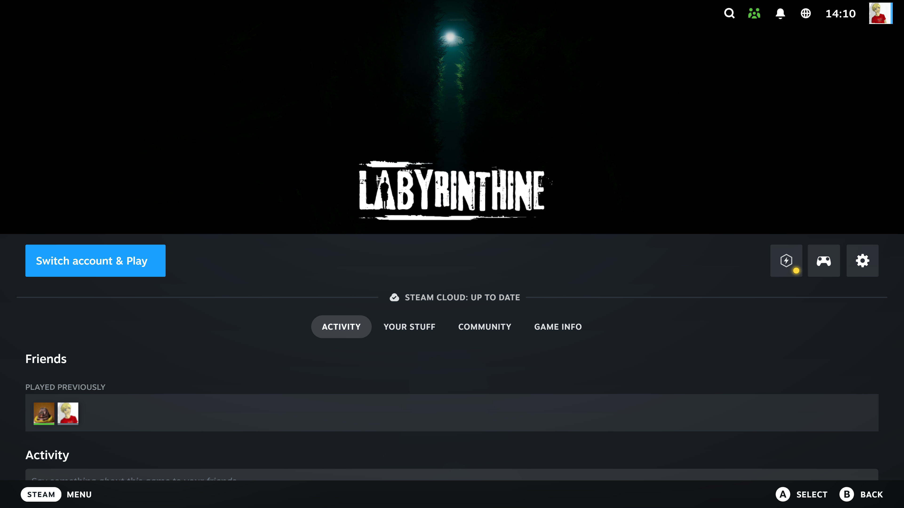
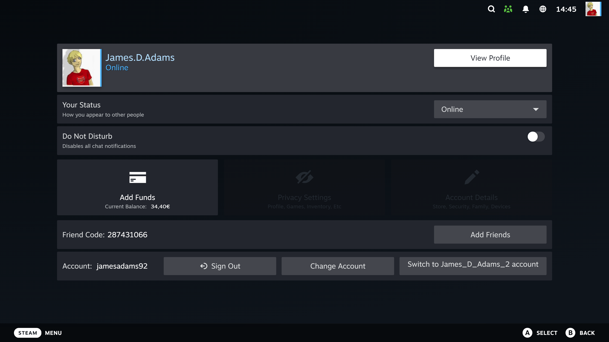

[English](README.md) · **Français**

# Steam Switch (plugin Decky Loader)

Sur la page d'un jeu qui appartient à **un autre compte Steam** déjà connecté sur ce PC, Steam affiche
un bouton **Borrow**. Ce plugin le remplace par « Switch account & Play » : il redémarre Steam
connecté au compte qui possède le jeu et lance le jeu sur ce compte, ce qui revient à faire la danse
manuelle (changer d'utilisateur, attendre l'écran de connexion, choisir le compte, lancer) en un clic.



Il ajoute aussi un bouton **Switch to &lt;pseudo&gt; account** à la page des paramètres du compte
(`Account`, à côté de Sign Out / Change Account), afin que les deux comptes puissent être échangés sans
passer par l'écran de déconnexion de Steam :



## Fonctionnement

1. Le plugin surveille la route de Big Picture (`/routes/library/app/<appid>`).
2. Pour ce jeu, il lit, sur le PC :
   - `config/loginusers.vdf` - les comptes dont Steam se souvient (avec `RememberPassword`),
   - `steamapps/appmanifest_<appid>.acf` - `StateFlags` (installé) et `LastOwner` (le compte qui
     possède le jeu),
   - `HKCU\Software\Valve\Steam\ActiveProcess\ActiveUser` - le compte connecté actuellement.
   L'`overview.owner_account_id` de la page est aussi utilisé, si bien que le compte propriétaire est
   connu même quand le manifeste n'indique aucun propriétaire.
3. Si le jeu est installé et possédé par un **autre** compte mémorisé, le plugin réécrit le bouton
   natif sur place : le libellé devient *Switch account & Play* et chaque activation (clic souris,
   bouton A de la manette, `Focusable` de Steam) appelle le plugin au lieu d'emprunter. Le balisage, la
   taille, la couleur, le survol et le focus de Steam ne sont pas touchés.
4. Le clic démarre `tools/switch.ps1` **détaché**, car l'étape suivante est la mort de Steam : quitter
   Steam, attendre la disparition de `steam.exe` (Steam réécrit `loginusers.vdf` à la fermeture),
   marquer le compte propriétaire comme compte de connexion automatique (`AutoLogin` dans le fichier,
   `AutoLoginUser` dans le registre), démarrer Steam avec `-bigpicture`, attendre que l'utilisateur
   actif soit ce compte, puis envoyer `steam://rungameid/<appid>`.
5. Sur la page des paramètres du compte (`/routes/account`), le même helper est utilisé sans jeu : un
   bouton `Switch to <pseudo> account` est cloné depuis le bouton Change Account de Steam et ajouté à
   cette ligne, un bouton par autre compte mémorisé.
6. La session Steam suivante affiche un toast avec le résultat : *Signed in as X; the game is
   starting.* (ou *Signed in as X.* pour un changement de compte seul), ou la raison pour laquelle
   l'opération n'a pas abouti.

Rien n'est codé en dur : les noms de comptes, les ids et les chemins viennent de l'installation Steam
locale, et le compte vers lequel basculer est toujours celui qui possède le jeu.
Le même zip fonctionne sur n'importe quel PC Windows dont Steam mémorise au moins deux comptes.

## Prérequis

- Windows, Decky Loader, Steam Big Picture (l'interface du plugin est celle d'un plugin Big Picture).
- Le compte propriétaire doit s'être connecté au moins une fois sur ce PC **avec « remember my
  password »** (`RememberPassword` dans `loginusers.vdf`). Sans cela, Steam demande le mot de passe
  sur l'écran de connexion et le changement ne peut pas être automatique.
- Le jeu doit être installé sur ce PC (c'est le cas, puisque la page empruntée s'affiche).

## Installation

[](https://raw.githubusercontent.com/JamesDAdams/my-decky-plugins/main/releases/SteamSwitch-decky-0.1.0.zip)

1. Téléchargez `SteamSwitch-decky-0.1.0.zip` depuis `releases/`.
2. Decky (menu `...`) -> **Install from zip file**.
3. Redémarrez Steam (Decky recharge les plugins au démarrage ; le backend Python n'est pas rechargé à
   chaud).

## Menu d'accès rapide

Le panneau QAM liste les comptes enregistrés sur ce PC, celui qui est connecté, le dernier changement
et son résultat. Il n'y a rien à configurer.

## Limites et cas d'échec

| Situation | Comportement |
| --- | --- |
| Jeu possédé par le compte connecté | bouton inchangé (Play normal) |
| Jeu non installé | bouton inchangé (`not installed` dans le journal) |
| Compte propriétaire non mémorisé sur ce PC | bouton inchangé, raison journalisée |
| Steam Guard / session expirée | Steam demande le mot de passe ; le helper signale `login-failed` et la session suivante explique pourquoi |
| Changement déjà en cours | le clic est refusé avec un toast, pas de second redémarrage de Steam |
| Un jeu est lancé | il est fermé par le redémarrage (Steam ne peut pas changer de compte autrement) |
| Bouton de la page du compte à la manette | le bouton ajouté répond à la souris et au clavier ; le focus manette de Steam ne connaît que ses propres focusables React (le bouton de la page du jeu garde le focus manette, car il remplace un bouton natif) |
| Pas Windows (SteamOS, Linux) | le plugin se charge, le bouton reste natif, le QAM indique que ce n'est pas pris en charge |

## Développement

```powershell
powershell -ExecutionPolicy Bypass -File .\build.ps1      # typecheck, bundle, ASCII check, tests, install, zip
powershell -ExecutionPolicy Bypass -File .\build.ps1 -NoInstall
```

- `main.py` - lit l'installation Steam locale, décide, lance le helper (~13 tests unitaires dans
  `tests/test_main.py`, sans Steam : la structure est reconstruite dans un dossier temporaire).
- `src/gameWatcher.ts` - surveillance de la route + réécriture DOM/fiber du bouton de lecture, via
  `executeInTab` dans `Steam Big Picture Mode` (le document du plugin fait 1x1).
- `tools/switch.ps1` - le helper détaché (arrêt, `loginusers.vdf` + registre, redémarrage, attente de
  la connexion, lancement). Écrit `homebrew/data/SteamSwitch/switch-state.json` et
  `switch-helper.log`.
- `tools/switch-test.ps1` - exécution autonome de la même séquence, pour récupérer un PC à la main :
  `powershell -File tools\switch-test.ps1 -Target <account> -AppId <appid>`.

Deux constats à garder en tête, tous deux mesurés sur cette machine :

- le plugin doit lancer le helper avec `CREATE_NO_WINDOW` : un `powershell.exe` en `DETACHED_PROCESS`
  n'exécute jamais le script (pas de console, il se termine immédiatement) ;
- `executeInTab` renvoie `{success, result}` sur cette version de Decky, pas la chaîne brute.

## Licence

MIT
