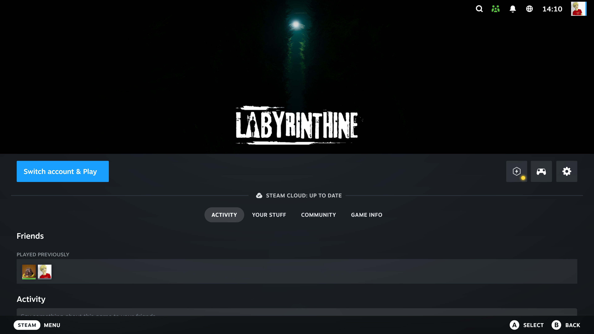
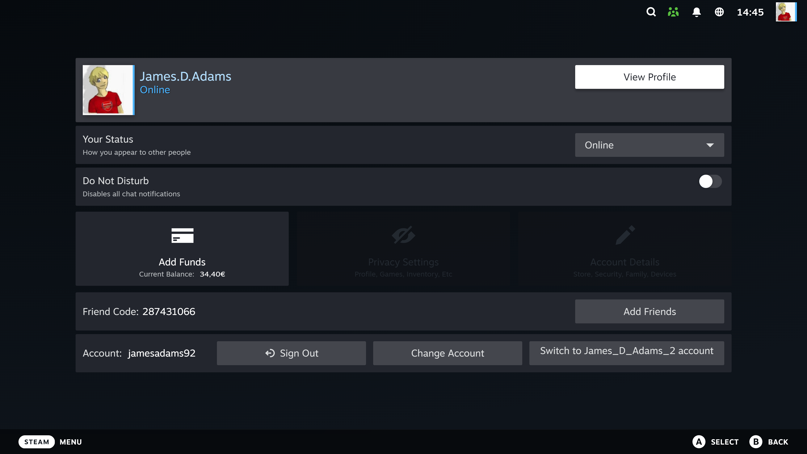

**English** · [Français](README.fr.md)

# Steam Switch (Decky Loader plugin)

On the page of a game that belongs to **another Steam account** already signed in on this PC,
Steam shows a **Borrow** button. This plugin replaces it with **Switch account & Play**: it
restarts Steam signed into the account that owns the game and launches the game there, which
is the manual dance (switch user, wait for the login screen, pick the account, launch) done
in one click.



It also adds a **Switch to <other persona> account** button to the account settings page
(`Account`, next to Sign Out / Change Account), so the two accounts can be swapped without
going through Steam's sign-out screen:



## How it works

1. The plugin watches the Big Picture route (`/routes/library/app/<appid>`).
2. For that game it reads, on the PC:
   - `config/loginusers.vdf` - the accounts Steam remembers (with `RememberPassword`),
   - `steamapps/appmanifest_<appid>.acf` - `StateFlags` (installed) and `LastOwner` (the
     account that owns the game),
   - `HKCU\Software\Valve\Steam\ActiveProcess\ActiveUser` - the account signed in now.
   The page's own `overview.owner_account_id` is used too, so the owning account is known even
   when the manifest has no owner.
3. If the game is installed and owned by **another** remembered account, the plugin rewrites
   the native button in place: the label becomes *Switch account & Play* and every activation
   (mouse click, gamepad A, Steam's own `Focusable`) calls the plugin instead of borrowing.
   Steam's markup, size, colour, hover and focus are untouched.
4. Clicking starts `tools/switch.ps1` **detached**, because the next step is Steam dying:
   quit Steam, wait for `steam.exe` to be gone (Steam rewrites `loginusers.vdf` on exit), mark
   the owning account as the auto-login one (`AutoLogin` in the file, `AutoLoginUser` in the
   registry), start Steam with `-bigpicture`, wait until the active user is that account, then
   send `steam://rungameid/<appid>`.
5. On the account settings page (`/routes/account`) the same helper is used with no game: a
   `Switch to <persona> account` button is cloned from Steam's own Change Account button and
   appended to that row, one button per other remembered account.
6. The added buttons are DOM clones, so they are registered in Steam's gamepad navigation tree (`SteamUIStore.NavigationManager`) by copying the navigation node of the native Change Account button: the controller reaches them like any native button.
7. The next Steam session shows a toast with the result: *Signed in as X; the game is
   starting.* (or *Signed in as X.* for an account-only switch), or the reason it did not
   complete.

Nothing is hard-coded: account names, ids and paths come from the local Steam install, and the
account to switch to is always the one that owns the game. The same zip works on any Windows PC
whose Steam remembers at least two accounts.

## Requirements

- Windows, Decky Loader, Steam Big Picture (the plugin's UI is a Big Picture plugin).
- The owning account must have signed in on this PC at least once **with "remember my
  password"** (`RememberPassword` in `loginusers.vdf`). Without it Steam asks for the password
  on the login screen and the switch cannot be automatic.
- The game must be installed on this PC (it is, since it shows the borrowed page).

## Install

[](https://raw.githubusercontent.com/JamesDAdams/my-decky-plugins/main/releases/SteamSwitch-decky-0.1.3.zip)

1. Download `SteamSwitch-decky-0.1.3.zip` from `releases/`.
2. Decky (`...` menu) -> **Install from zip file**.
3. Restart Steam (Decky reloads plugins on start; the Python backend is not hot-reloaded).

## Quick Access Menu

The QAM panel lists the accounts saved on this PC, which one is signed in, the last switch and
its result. There is nothing to configure.

## Limits and failure modes

| Situation | Behaviour |
| --- | --- |
| Game owned by the signed-in account | button untouched (normal Play) |
| Game not installed | button untouched (`not installed` in the log) |
| Owning account not remembered on this PC | button untouched, reason logged |
| Steam Guard / expired session | Steam asks for the password; the helper reports `login-failed` and the next session shows why |
| Switch already running | the click is refused with a toast, no second Steam restart |
| A game is running | it is closed by the restart (Steam cannot switch account otherwise) |
| Account page button with a gamepad | works: the added button gets a navigation node copied from Steam's own Change Account button, so Left/Right reaches it exactly like the native buttons (measured with `plugins/scskiller/tools/nav-audit.mjs`) |
| Not Windows (SteamOS, Linux) | the plugin loads, the button stays native, the QAM says it is unsupported |

## Development

```powershell
powershell -ExecutionPolicy Bypass -File .\build.ps1      # typecheck, bundle, ASCII check, tests, install, zip
powershell -ExecutionPolicy Bypass -File .\build.ps1 -NoInstall
```

- `main.py` - reads the local Steam install, decides, spawns the helper (~13 unit tests in
  `tests/test_main.py`, no Steam needed: the layout is rebuilt in a temp folder).
- `src/gameWatcher.ts` - route watcher + the DOM/fiber rewrite of the play button, through
  `executeInTab` into `Steam Big Picture Mode` (the plugin's own document is 1x1).
- `tools/switch.ps1` - the detached helper (shutdown, `loginusers.vdf` + registry, restart,
  wait for sign-in, launch). Writes `homebrew/data/SteamSwitch/switch-state.json` and
  `switch-helper.log`.
- `tools/switch-test.ps1` - standalone run of the same sequence, for recovering a PC by hand:
  `powershell -File tools\switch-test.ps1 -Target <account> -AppId <appid>`.

Two findings worth keeping in mind, both measured on this machine:

- the plugin must spawn the helper with `CREATE_NO_WINDOW`: a `DETACHED_PROCESS`
  `powershell.exe` never runs the script (no console, it exits immediately);
- `executeInTab` resolves to `{success, result}` on this Decky build, not to the raw string.

## License

MIT
